# DynaClade

Code for the paper **The Computational Grammar of Human Behaviour in a Biological Environment**.

DynaClade discovers recurring actions in continuous human movement and provides tools for analyzing their temporal and spatial organization. Developed for freely moving participants in virtual-reality (VR) foraging environment, the pipeline combines motion-capture curation, kinematic feature extraction, unsupervised clustering, label prediction, and behavioural sequence analysis.

## Overview

The pipeline consists of four main stages:

1. **Data preparation:** clean motion-capture recordings and extract kinematic features.
2. **Action discovery:** identify recurring movement patterns using UMAP and HDBSCAN.
3. **Label prediction:** train a random-forest classifier to extend the discovered labels to additional recordings.
4. **Behavioural analysis:** quantify action frequencies, durations, sequences, transitions, and spatial distributions.

Action discovery is unsupervised; random-forest classifier is trained on labels obtained from the discovery stage.

## Installation

### Requirements

- [Conda](https://docs.conda.io/) (Anaconda or Miniconda)
- [FFmpeg](https://ffmpeg.org/download.html) for motion-capture preprocessing
- Python dependencies provided in `environment.yml` or `requirements.txt`

Clone the repository:

```bash
git clone https://github.com/bachlab/DynaClade.git
cd DynaClade
```

**Option 1 — Conda environment (recommended):**

```bash
conda env create -f environment.yml
conda activate dynaclade
```

**Option 2 — pip dependencies:**

```bash
conda create -n dynaclade python=3.11
conda activate dynaclade
pip install -r requirements.txt
```

> **Compatibility:** The code is tested on Windows 11 machine with Intel(R) Core(TM) i9-14900HX, and GPU NVIDIA GeForce RTX 4070 Ti SUPER.


## Usage

The scripts are located in `src/`. The commands below assume that you have changed into this directory:

```bash
cd src
```

Replace the **uppercase placeholders** (such as `<INPUT_DIR>` and `<OUTPUT_DIR>`) with locations appropriate to your dataset. These are illustrative commands based on the original analysis configuration, not universal defaults. For details on available options, consult each script's command-line interface.


### 1. Data curation

Clean raw motion-capture recordings, check marker and segment quality, and export curated data.

<p align="center">
  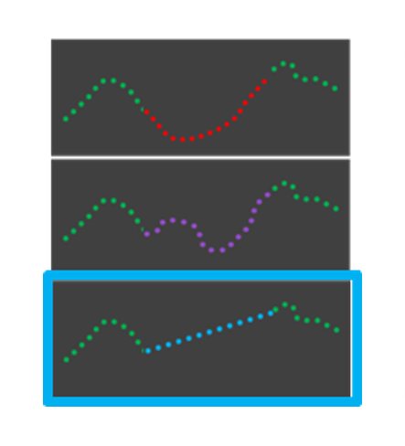
</p>

**Script:** `do_mocap_clean.py`

```bash
python do_mocap_clean.py -o -ow -sm -d "<RAW_MOCAP_DIR>" -f "<FFMPEG_DIR>" -sr 200 -r --marker-quality-threshold 95 --marker-quality-sub-threshold 95 --segment-length-tolerance 10 --mean-segment-length-deviation-threshold 95 --individual-segment-length-deviation-threshold 95 --stick-figure-template "qualisys_csv" --plot-frame-rate 5 --output "<CURATED_OUTPUT_DIR>"
```

| Argument | Description |
| --- | --- |
| `-d` | Directory containing raw motion-capture data. |
| `-f` | FFmpeg directory. |
| `-sr` | Motion-capture sampling rate. |
| `--marker-quality-threshold`, `--marker-quality-sub-threshold` | Marker-quality criteria. |
| `--segment-length-tolerance` | Tolerance for segment lengths. |
| `--mean-segment-length-deviation-threshold`, `--individual-segment-length-deviation-threshold` | Segment-length quality criteria. |
| `--stick-figure-template` | Skeleton format (for example, `qualisys_csv`). |
| `--plot-frame-rate` | Frame rate for generated visualizations. |
| `--output` | Directory for curated results. |

The switches `-o`, `-ow`, `-sm`, and `-r` are retained from the original workflow; see the script for their exact behaviour.

### 2. Feature engineering

Extract kinematic features from curated motion-capture recordings.

<p align="center">
  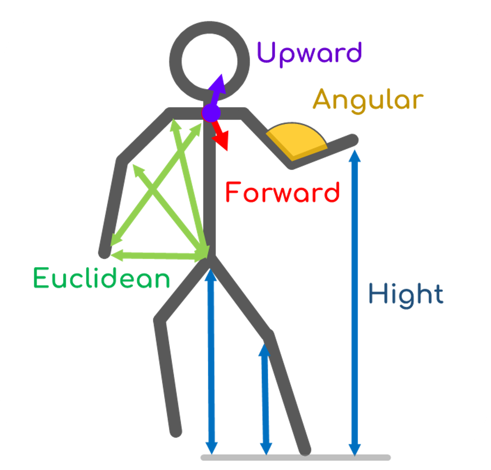
</p>

**Script:** `get_feature_matrix.py`

```bash
python get_feature_matrix.py -d "<CURATED_MOCAP_DIR>" -sr 10 -od "<FEATURE_OUTPUT_DIR>" -sm "qualisys_csv" -c "<CURATED_TRIALS_CSV>"
```

| Argument | Description |
| --- | --- |
| `-d`, `--data` | Directory containing curated motion-capture CSV files. |
| `-sr`, `--sample_rate` | Target sample rate; use the original rate to avoid downsampling. |
| `-od`, `--output_dir` | Feature-matrix output directory. |
| `-sm`, `--stickfigure_mode` | Skeleton format. |
| `-c`, `--curated_list` | Trial metadata CSV, with participant, session, and trial information. |

### 3. Action discovery (clustering)

Identify recurring movement patterns from the feature matrix using UMAP and HDBSCAN.

<p align="center">
  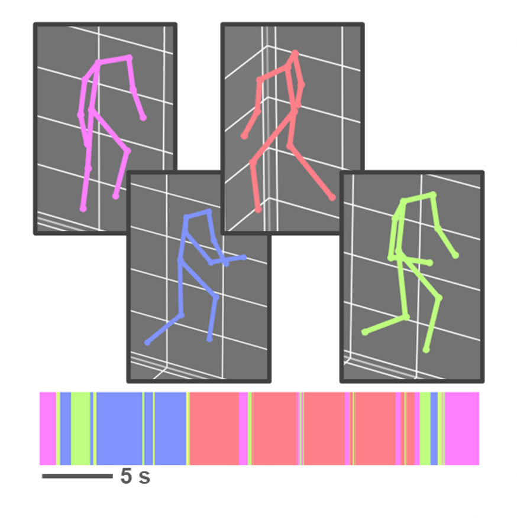
</p>

**Script:** `get_clusters.py`

```bash
python get_clusters.py --path "<FEATURE_MATRIX_DIR>" --data-collection-rate 10 --output-path "<CLUSTER_OUTPUT_DIR>" --curated-list "<CURATED_TRIALS_CSV>" --umap-n-neighbors 300 --hdbscan-cluster-size 300 --hdbscan-epsilon 0
```

| Argument | Description |
| --- | --- |
| `--path` | Directory containing feature matrices. |
| `--data-collection-rate` | Sampling rate of the feature data. |
| `--output-path` | Clustering output directory. |
| `--curated-list` | Curated trial metadata CSV. |
| `--umap-n-neighbors` | Number of neighbours used by UMAP. |
| `--hdbscan-cluster-size` | HDBSCAN minimum cluster-size setting. |
| `--hdbscan-epsilon` | HDBSCAN cluster-selection epsilon. |

### 4. Random-forest classifier

The optional classifier stage can be used to predict discovered action labels for additional observations.

<p align="center">
  
</p>

**Script:** `random_forest_classifier.py`

**Training**

```bash
python random_forest_classifier.py --train --feature-matrix-train "<LABELED_FEATURES_CSV>" --labels-column "L0" --ignore-unlabeled-train
```

| Argument | Description |
| --- | --- |
| `--train` | Run classifier training. |
| `--feature-matrix-train` | Feature matrix with discovered action labels. |
| `--labels-column` | Column containing labels (for example, `L0`). |
| `--ignore-unlabeled-train` | Exclude unlabeled observations during training. |

**Prediction**

```bash
python random_forest_classifier.py --predict --feature-matrix-predict "<FEATURES_CSV>" --labels-column "L0" --classifier-file "<CLASSIFIER_PKL>" --label-encoder-file "<LABEL_ENCODER_PKL>" --probability-threshold 0.0 --only-predict-unlabeled
```

| Argument | Description |
| --- | --- |
| `--predict` | Run classifier prediction. |
| `--feature-matrix-predict` | Feature matrix for prediction. |
| `--labels-column` | Target label column. |
| `--classifier-file` | Trained classifier (`.pkl`). |
| `--label-encoder-file` | Fitted label encoder (`.pkl`). |
| `--probability-threshold` | Minimum prediction probability; predictions below the threshold are assigned `-1`. |
| `--only-predict-unlabeled` | Only predict labels for unlabeled observations. |

## Visualization and analysis

The following scripts visualize the discovered action dictionary and characterize its temporal and spatial organization.

> **Data dependency:** Several downstream analyses require `vr_to_mocap_mapping.csv`, generated by `get_syllable_counts.py`. Run the usage-frequency analysis first when this mapping is not yet available.

### 5. Action hierarchy

Visualize the hierarchy of discovered action classes.

<p align="center">
  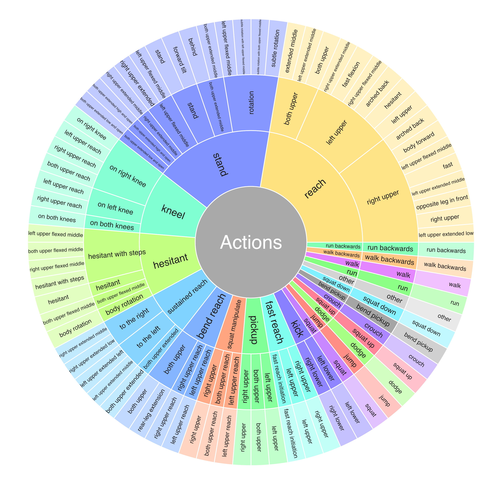
</p>

An [interactive version](resources/movement_hierarchy.html) is provided in the repository.

**Script:** `plot_dictionary_hierarchy.py`

```bash
python plot_dictionary_hierarchy.py --csv "<LABEL_DESCRIPTIONS_CSV>" --colors "<COLOUR_MAP_PKL>" --output_dir "<OUTPUT_DIR>"
```

| Argument | Description |
| --- | --- |
| `--csv`, `--csv_path` | CSV containing the hierarchical action labels. |
| `--colors`, `--colors_pickle` | Saved colour-map object. |
| `--output`, `--output_file` | HTML output file name; default is `movement_hierarchy.html`. |
| `--output_dir` | Output directory. |
| `--title` | Figure title. |
| `--levels` | Hierarchical label columns; defaults include `L0`, `L01`, and `L012`. |

### 6. Action sequences

Plot frame-level action labels over individual trials.

<p align="center">
  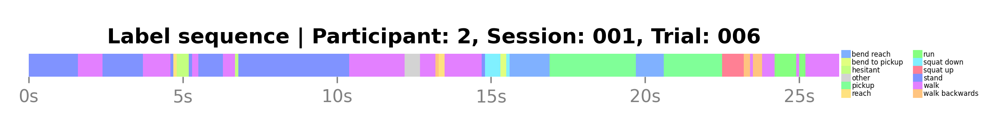
</p>

**Script:** `plot_syllable_sequences.py`

```bash
python plot_syllable_sequences.py --data-file "<PREDICTIONS_CSV>" --labels-column "predicted_label" --data-collection-rate 10 --output-path "<OUTPUT_DIR>" --colour-map-object "<COLOUR_MAP_PKL>"
```

| Argument | Description |
| --- | --- |
| `--data-file` | Labelled observations with participant, session, trial, and label columns. |
| `--labels-column` | Label column. |
| `--data-collection-rate` | Data sampling rate. |
| `--output-path` | Output directory. |
| `--colour-map-object` | Saved colour map. |

### 7. Action usage frequency

Compute the occurrence and cumulative frequency of discovered actions across trials.

<p align="center">
  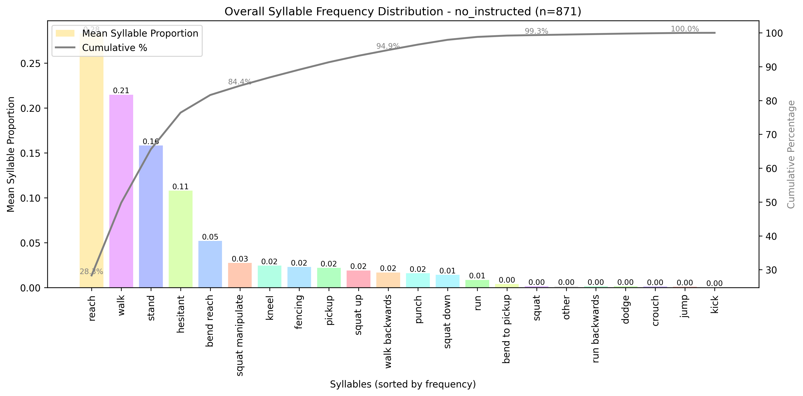
</p>

**Script:** `get_syllable_counts.py`

```bash
python get_syllable_counts.py --labels-path "<PREDICTIONS_CSV>" --label-column "predicted_label" --vr-metadata-path "<VR_METADATA_CSV>" --output-dir "<OUTPUT_DIR>" --colour-map-object "<COLOUR_MAP_PKL>" --failed-trials-path "<EXCLUDED_TRIALS_CSV>"
```

| Argument | Description |
| --- | --- |
| `--labels-path` | Labelled observations CSV. |
| `--label-column` | Column containing action labels. |
| `--vr-metadata-path` | VR trial metadata CSV. |
| `--output-dir` | Output directory. |
| `--colour-map-object` | Saved colour map. |
| `--failed-trials-path` | CSV listing excluded trials. |

This stage also generates the VR-to-motion-capture mapping used by subsequent analyses.

### 8. Action duration

Characterize the duration of action segments.

<p align="center">
  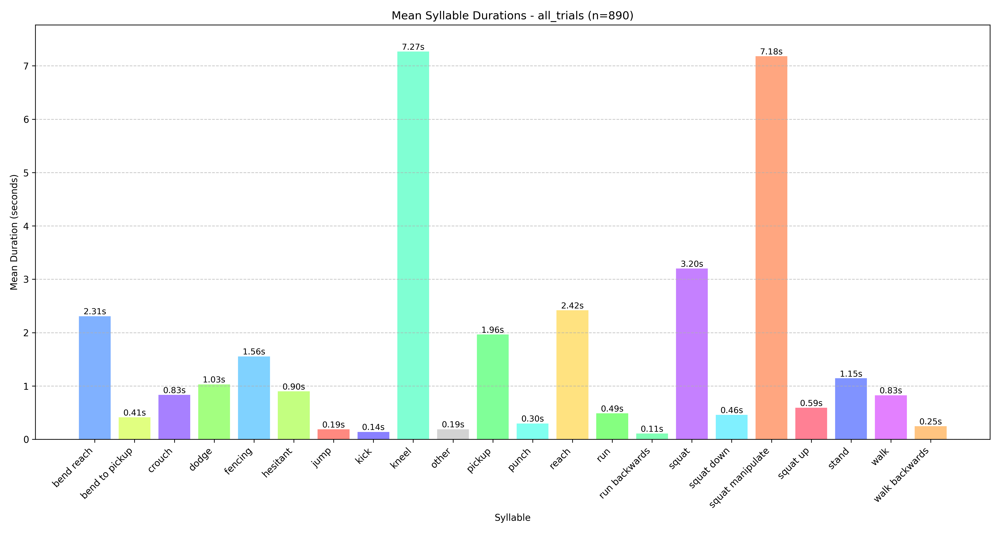
</p>

**Script:** `get_syllable_durations.py`

```bash
python get_syllable_durations.py --labels-path "<PREDICTIONS_CSV>" --label-column "predicted_label" --metadata-path "<VR_TO_MOCAP_MAPPING_CSV>" --output-dir "<OUTPUT_DIR>" --colour-map-object "<COLOUR_MAP_PKL>" --failed-trials-path "<EXCLUDED_TRIALS_CSV>"
```

| Argument | Description |
| --- | --- |
| `--labels-path` | Labelled observations CSV. |
| `--label-column` | Column containing action labels. |
| `--metadata-path` | VR-to-motion-capture mapping CSV. |
| `--output-dir` | Output directory. |
| `--colour-map-object` | Saved colour map. |
| `--failed-trials-path` | CSV listing excluded trials. |

### 9. Action n-grams

Quantify recurring action subsequences and compare their frequencies against permutation-based controls.

<p align="center">
  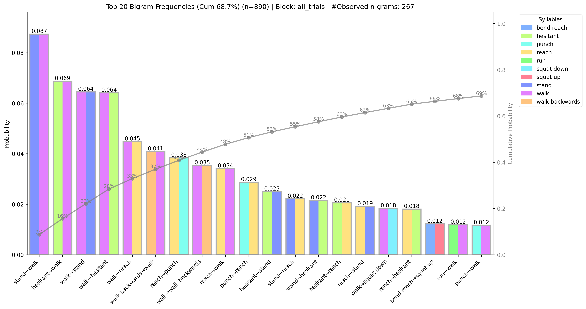
</p>

**Script:** `get_syllable_ngrams.py`

```bash
python get_syllable_ngrams.py --labels-path "<PREDICTIONS_CSV>" --label-column "predicted_label" --metadata-path "<VR_TO_MOCAP_MAPPING_CSV>" --output-dir "<OUTPUT_DIR>" --fps 10 --colour-map-object "<COLOUR_MAP_PKL>" --n-perm 1000 --ngram-sizes 2 3 4 5 6 7 8 9 10 --failed-trials-path "<EXCLUDED_TRIALS_CSV>"
```

| Argument | Description |
| --- | --- |
| `--labels-path` | Labelled observations CSV. |
| `--label-column` | Column containing action labels. |
| `--metadata-path` | VR-to-motion-capture mapping CSV. |
| `--output-dir` | Output directory. |
| `--fps` | Sampling rate in frames per second. |
| `--colour-map-object` | Saved colour map. |
| `--n-perm` | Number of permutations. |
| `--ngram-sizes` | N-gram orders to analyse. |
| `--failed-trials-path` | CSV listing excluded trials. |

### 10. Spatial and temporal action usage

Relate discovered actions to participant locations, VR objects, and experimental conditions.

<p align="center">
  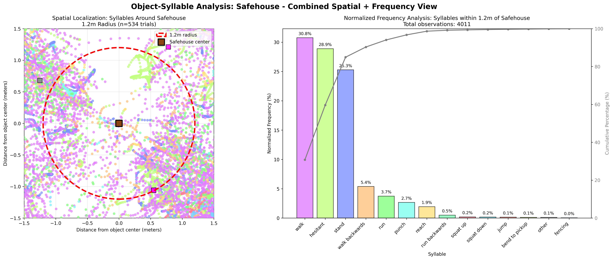
</p>

**Script:** `do_location_based_syllable_usage_analysis.py`

```bash
python do_location_based_syllable_usage_analysis.py --labels-path "<PREDICTIONS_CSV>" --experimental-conditions "<VR_TO_MOCAP_MAPPING_CSV>" --label-column "predicted_label" --output-dir "<OUTPUT_DIR>" --coords-dir "<CURATED_MOCAP_DIR>" --colour-map-object "<COLOUR_MAP_PKL>" --data-dir "<VR_DATA_DIR>" --debug --alignment-to-participant --plot-trackers --spatial-analysis --object-syllable-analysis --failed-trials-path "<EXCLUDED_TRIALS_CSV>"
```

| Argument | Description |
| --- | --- |
| `--labels-path` | Labelled observations CSV. |
| `--experimental-conditions` | Experimental conditions / VR-to-motion-capture mapping CSV. |
| `--label-column` | Column containing action labels. |
| `--output-dir` | Output directory. |
| `--coords-dir` | Directory with curated motion-capture coordinates. |
| `--colour-map-object` | Saved colour map. |
| `--data-dir` | VR tracking and scene-object data directory. |
| `--debug` | Enable debugging output. |
| `--alignment-to-participant` | Enable participant-aligned coordinates. |
| `--plot-trackers` | Generate tracker visualizations. |
| `--spatial-analysis` | Enable spatial analyses. |
| `--object-syllable-analysis` | Enable analysis of actions relative to scene objects. |
| `--failed-trials-path` | CSV listing excluded trials. |

### 11. Action transition matrices

Compute and visualize transitions between successive discovered actions.

<p align="center">
  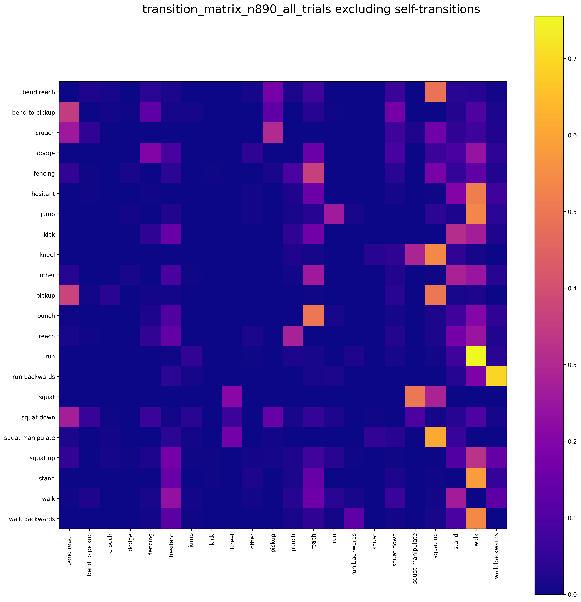
</p>

**Script:** `get_syllable_transition_matrices.py`

```bash
python get_syllable_transition_matrices.py --labels-path "<PREDICTIONS_CSV>" --label-column "predicted_label" --metadata-path "<VR_TO_MOCAP_MAPPING_CSV>" --output-dir "<OUTPUT_DIR>" --skip-trial-matrices --failed-trials-path "<EXCLUDED_TRIALS_CSV>"
```

| Argument | Description |
| --- | --- |
| `--labels-path` | Labelled observations CSV. |
| `--label-column` | Column containing action labels. |
| `--metadata-path` | VR-to-motion-capture mapping CSV. |
| `--output-dir` | Output directory. |
| `--skip-trial-matrices` | Skip individual trial-level transition matrices. |
| `--failed-trials-path` | CSV listing excluded trials. |

### 12. Action transition graphs

Visualize the structure of action transitions as graphs.

<p align="center">
  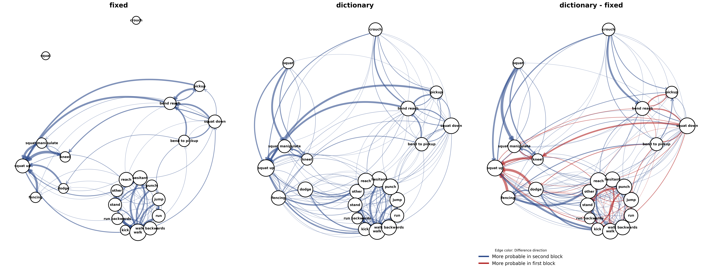
</p>

**Script:** `get_syllable_transition_graphs.py`

```bash
python get_syllable_transition_graphs.py --labels-path "<PREDICTIONS_CSV>" --label-column "predicted_label" --metadata-path "<VR_TO_MOCAP_MAPPING_CSV>" --output-dir "<OUTPUT_DIR>" --colour-map-object "<COLOUR_MAP_PKL>" --permutation-threshold --failed-trials-path "<EXCLUDED_TRIALS_CSV>"
```

| Argument | Description |
| --- | --- |
| `--labels-path` | Labelled observations CSV. |
| `--label-column` | Column containing action labels. |
| `--metadata-path` | VR-to-motion-capture mapping CSV. |
| `--output-dir` | Output directory. |
| `--colour-map-object` | Saved colour map. |
| `--permutation-threshold` | Apply a permutation-based threshold to graph edges. |
| `--failed-trials-path` | CSV listing excluded trials. |

## Authors

**The Computational Grammar of Human Behaviour in a Biological Environment:** [Ulises Daniel Serratos Hernandez](https://github.com/uSerratos), Uzay Gökay, Lukas Kornemann, Yonatan Hutabarat, Debadrita Sen, Dominik R. Bach.

**Development & Implementation:** [Ulises Daniel Serratos Hernandez](https://github.com/uSerratos).

## Citation

If you use this repository, please cite our paper. A full citation and link to the open-access manuscript will be added when available.